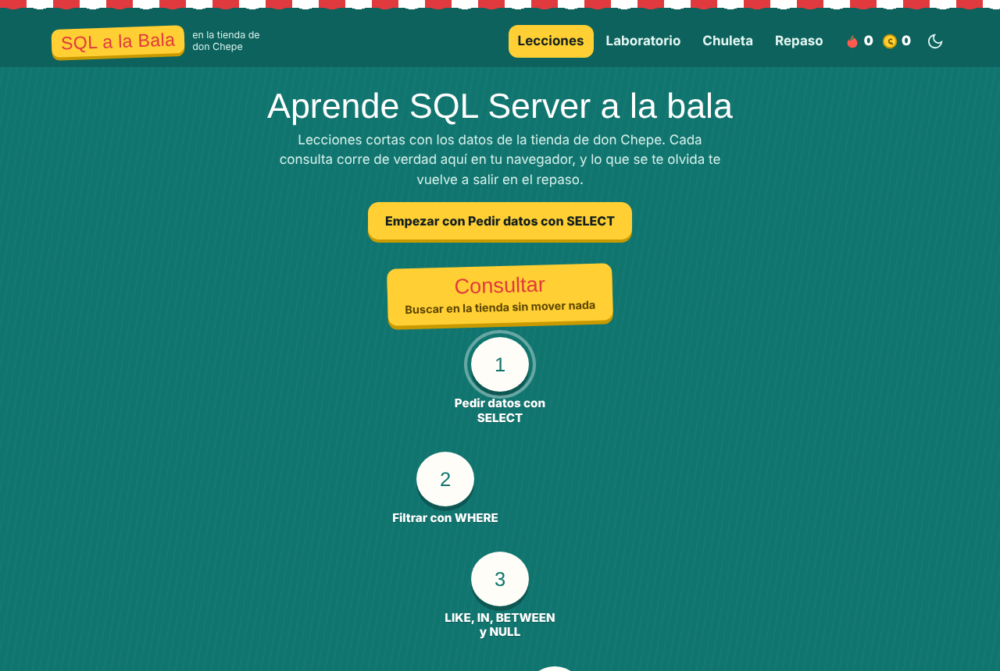
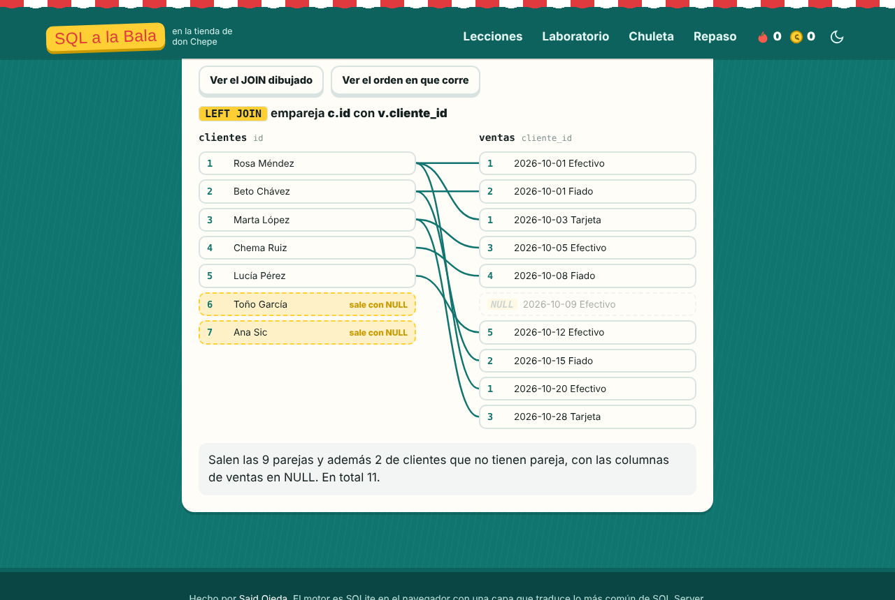
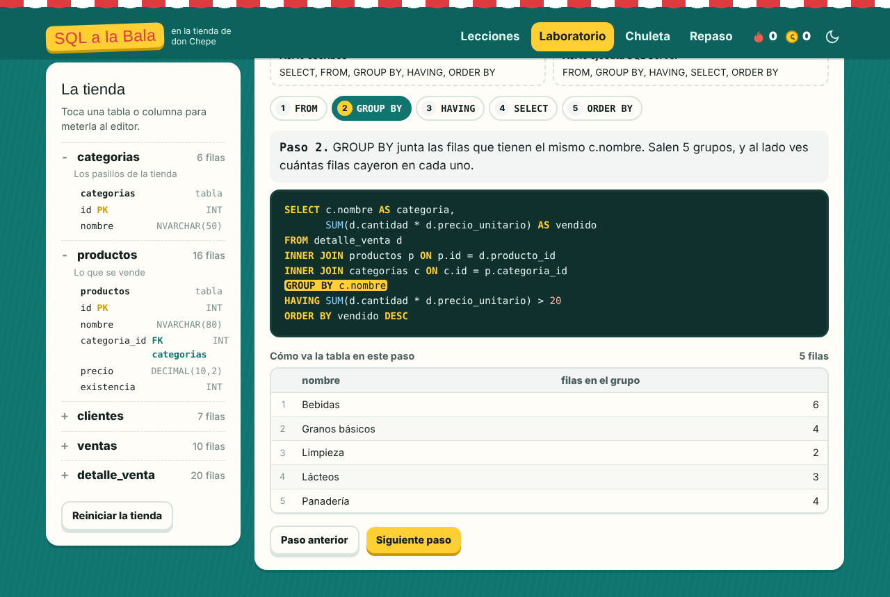
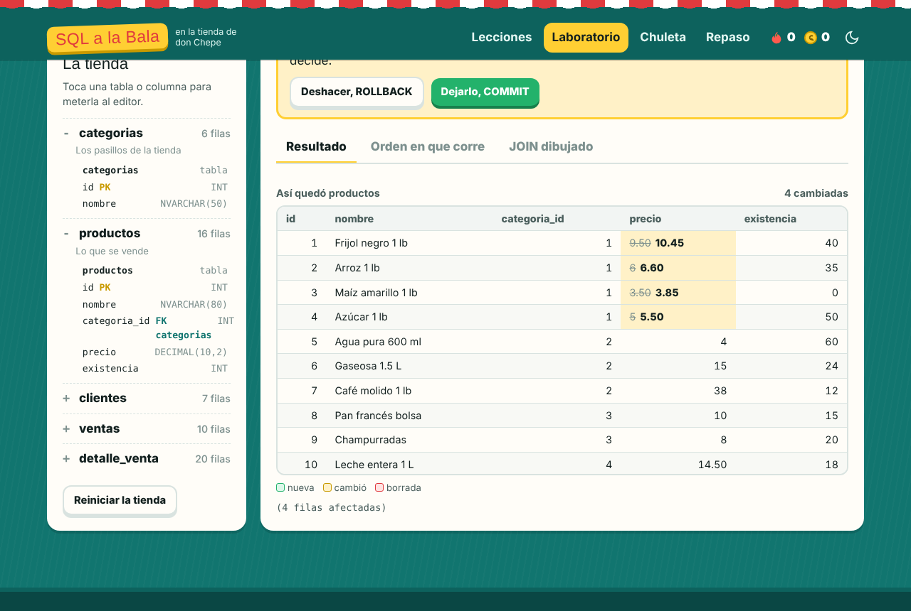
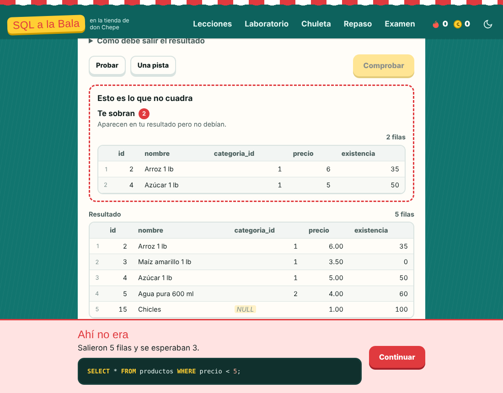
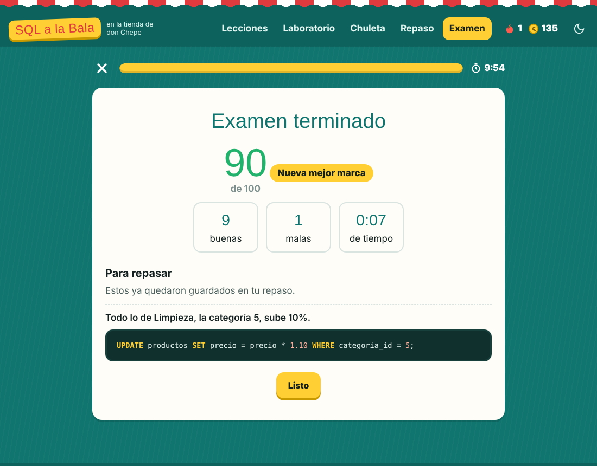

# SQL a la Bala

Una app para aprender SQL Server con lecciones cortas, retos y repaso, como las apps de idiomas. Todo se practica con los datos de la tienda de don Chepe, y cada consulta corre de verdad en el navegador.

**Pruébala:** https://said1ojeda.github.io/sql-a-la-bala/



## Por qué

Los `INSERT`, `UPDATE`, `DELETE` y los `JOIN` se olvidan si no se usan seguido, y casi todos los tutoriales solo te enseñan la sintaxis. Aquí lo importante es **ver qué pasa por dentro** y practicar hasta que salga sin pensar.

## Lo que tiene

- **18 lecciones en 5 unidades**: consultar, modificar, resumir, unir tablas y más allá. Incluye UPDATE y DELETE con JOIN como se escriben en SQL Server, CASE y crear tablas. Son 111 ejercicios en total.
- **Tres tipos de ejercicio**: escribir la consulta, armarla con fichas o escoger la respuesta. También hay de adivinar cuántas filas salen y de encontrar el error.
- **Revisión de verdad**: tu consulta y la solución corren cada una en una tienda nueva y se comparan los resultados. Si llegas a lo mismo por otro camino, también vale.
- **Qué no cuadra**: cuando fallas te enseña exactamente qué filas te faltaron y cuáles te sobraron, en vez de solo decir que está mal.
- **El JOIN dibujado**: las filas de las dos tablas con líneas entre las parejas. Las que no tienen pareja se quedan solas o salen con `NULL`, según el tipo de JOIN.
- **El orden real de la consulta**: la corre paso a paso como la ejecuta SQL Server, `FROM`, `WHERE`, `GROUP BY`, `HAVING`, `SELECT` y `ORDER BY`, mostrando la tabla en cada etapa.
- **Modo seguro**: antes de correr un `UPDATE` o `DELETE` sin `WHERE` te avisa cuántas filas va a tocar. Después de cualquier cambio te enseña qué filas cambiaron y te deja escoger entre `COMMIT` y `ROLLBACK`.
- **Repaso con cajas**: lo que fallas vuelve al día siguiente, luego a los 3 días, a la semana y así, hasta que se queda.
- **Examen a la bala**: 10 ejercicios al azar, 10 minutos y sin pistas. Al final ves tu nota, tu mejor marca y la solución de los que fallaste.
- **Mi avance**: XP, racha, avance por unidad y 13 medallas para ir ganando.
- **Chuleta**: los moldes de cada operación en el orden en que se escriben, y los errores de SQL Server que más salen con su número.
- **Racha y XP**, tema claro y oscuro, y funciona en el cel con teclas rápidas. Cuando escribes el nombre de una tabla aparecen también sus columnas.











## Cómo está hecho

Es HTML, CSS y JavaScript sin frameworks, así que se publica tal cual en GitHub Pages.

El motor es [sql.js](https://said1ojeda.github.io/SQL-a-la-Bala/), que es SQLite compilado para el navegador. Encima tiene una capa que traduce lo más común de SQL Server para que se escriba igual que en el trabajo:

| SQL Server | Cómo lo resuelve |
|---|---|
| `UPDATE p SET ... FROM productos p JOIN ...` y `DELETE d FROM ... JOIN ...` | se reescriben para SQLite con el mismo resultado |
| `TOP 5`, `OFFSET ... FETCH` | se vuelve `LIMIT`, también dentro de subconsultas |
| `GETDATE()`, `DATEDIFF`, `DATEADD`, `DATEPART`, `YEAR`, `MONTH`, `DAY` | funciones propias con las mismas reglas, el 31 más un mes cae en el último día del mes |
| `CONVERT(VARCHAR, fecha, 103)` | estilos 101, 103, 23, 108 y 120 |
| `ISNULL`, `LEN`, `LEFT`, `RIGHT`, `CHARINDEX` | equivalentes de SQLite o funciones propias |
| `'texto' + 'texto'` | se une igual que en SQL Server |
| `BEGIN TRAN`, `COMMIT`, `ROLLBACK`, `@@ROWCOUNT`, `SCOPE_IDENTITY()` | transacciones de verdad |
| `INT IDENTITY(1,1)`, `NVARCHAR(50)` | autoincremento y textos sin distinguir mayúsculas, como el collation por defecto |
| Columnas fuera del `GROUP BY` | da el error 8120 como SQL Server, aunque SQLite sí lo dejaría pasar |
| Agrupar por un alias del `SELECT` | da error como en SQL Server y explica por qué |
| Instrucciones sin punto y coma | se separan por renglón, como en SSMS |

Los errores salen explicados en español y con el número que tendrían en SQL Server, por ejemplo 207, 208, 547 y 8120.

| Archivo | Qué hace |
|---|---|
| `js/motor.js` | arranca SQLite, traduce, corre por lotes, compara resultados y saca las diferencias |
| `js/datos.js` | la tienda, esquema y datos |
| `js/lecciones.js` | las lecciones y sus ejercicios |
| `js/leccion.js` | el flujo de cada lección y la revisión |
| `js/visual.js` | el JOIN dibujado y el orden de ejecución |
| `js/app.js` | rutas, inicio, laboratorio, chuleta y repaso |
| `js/progreso.js` | XP, racha, repaso, examen y medallas, guardados en el navegador |

## La tienda de don Chepe

| Tabla | Qué guarda |
|---|---|
| `categorias` | los pasillos, uno de ellos sin productos |
| `productos` | 16 productos, dos sin categoría y tres que nunca se han vendido |
| `clientes` | 7 clientes, dos sin teléfono y dos que nunca han comprado |
| `ventas` | 10 ventas en efectivo, tarjeta o fiado, una de alguien de paso sin cliente |
| `detalle_venta` | qué llevó cada venta |

Los datos tienen a propósito los casos que hacen falta para entender `NULL`, `LEFT JOIN`, `FULL JOIN` y las llaves foráneas.

## Correrla en tu compu

No hay que instalar nada, solo servir la carpeta:

```bash
git clone https://github.com/Said1Ojeda/sql-a-la-bala.git
cd sql-a-la-bala
python -m http.server 8080
```

Y abres `http://localhost:8080`. Si abres el `index.html` con doble clic no carga, porque los módulos de JavaScript necesitan un servidor.

## Licencia

MIT, ver [LICENSE](LICENSE). sql.js también es MIT, el detalle está en [vendor/LEEME.md](vendor/LEEME.md).
